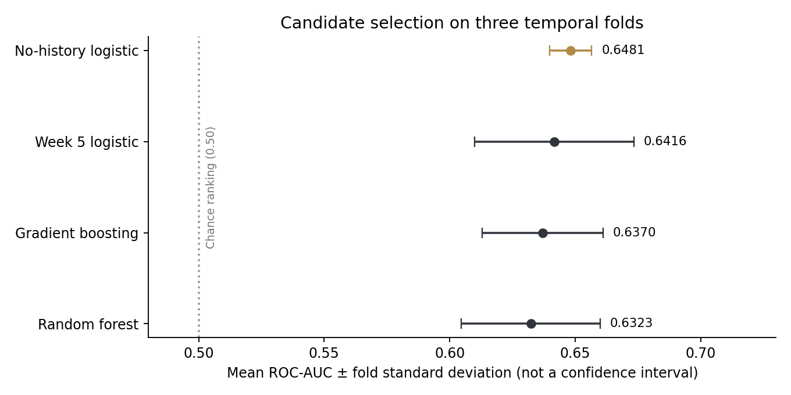
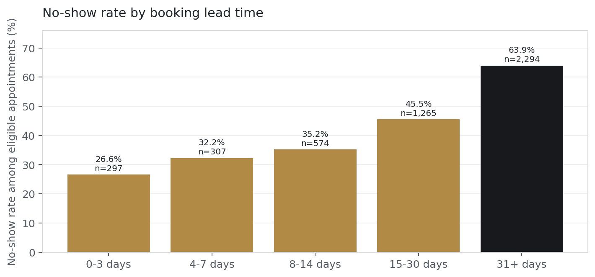

<p align="center">
  
</p>

# HealthConnect · Appointment no-show prediction

**From a clinic problem to a reproducible model, tested scoring interface, and descriptive dashboard.**

An AnalystLab Africa internship portfolio project by **Wilson Moses**, using fictional appointment records to investigate supportive patient follow-up. The repository consolidates Weeks 4–8 and subsequent validation performed on **11 October 2026**.

[Results](#results-and-trade-offs) · [Run the project](#run-the-project) · [Validation](docs/validation.md) · [Project history](docs/project_history.md) · [Dashboard](dashboard/index.html)

## Project at a glance

| | |
|---|---|
| Business question | Can information available at booking help identify appointments that may need supportive follow-up? |
| Data | 5,000 fictional appointments, 18 fields, 1,696 anonymised patient IDs |
| Prediction task | `No-Show = 1`, `Attended = 0`; 263 cancelled records excluded from the binary experiment |
| Selected model | Logistic regression without unverified patient-history features |
| Evaluation | Three internal temporal folds; separate **reused** 799-record comparison set |
| Delivered | Reproducible notebooks and scripts, saved pipeline, batch scoring, analytics dashboard, validation evidence |
| Status | Consolidated educational prototype; no clinical deployment or demonstrated attendance benefit |

## Problem and contribution

Missed appointments can leave capacity unused and disrupt patient support. HealthConnect explores whether booking information can inform a future supportive confirmation workflow. Predictive performance and actual improvement in attendance are separate questions; only the former is examined here.

My main contribution is **Data Science**: problem definition, source assessment, target and feature design, chronological evaluation, model comparison, and interpretation of errors. The Week 8 materials add a **descriptive analytics contribution**. The ML Engineering counterpart in the Week 6 record was **AI-simulated**; the code demonstrates local integration, not verified collaboration with another intern. This repository contains no implemented clinic chatbot, live service, or patient messaging system.

## Data and prediction boundary

The experiment scores at **booking time**, using age, distance, appointment type/time, and features derived from booking and appointment dates. Identifiers are returned for traceability but never used as predictors. Reminder activity, waiting time, and history counts are excluded from the selected candidate because their timing is unverified.

| Population | Records | Definition |
|---|---:|---|
| Original source | 5,000 | All appointments, unchanged |
| Binary-eligible appointments | 4,737 | 2,314 attended + 2,423 no-shows |
| Training | 3,682 | Appointment date before 1 March 2026 |
| Reused comparison | 799 | Booking date on/after 1 March 2026 |
| Purged boundary | 256 | Booked before the cutoff, appointment on/after it |

The binary no-show rate is **51.15%**. “Eligible” does not mean attended or a completed visit. Future cancellations are unknown at booking, so this conditional experiment does **not** validate scoring all future bookings.

Original source identity, dictionary, and known quality issues are documented in [data/README.md](data/README.md). Patient IDs overlap across partitions (579 shared IDs), so this is not an unseen-patient evaluation.

## Workflow and methods

| Stage | Implementation |
|---|---|
| Understand | Define the problem, prediction time, target, and data limitations |
| Prepare | Preserve source; parse dates explicitly; exclude cancellations; purge boundary outcomes |
| Fit and compare | Fit imputation, scaling, and encoding within each training fold; compare two logistic specifications and two tree models |
| Select | Rank by mean internal temporal ROC-AUC; choose the illustrative workload threshold from internal predictions |
| Validate | Reconcile metrics, inspect errors, test raw-input scoring, and reconcile analytics/dashboard values |
| Communicate | Present descriptive findings, prediction trade-offs, limitations, and historical evidence |

Python 3.12 · pandas · NumPy · scikit-learn · Matplotlib · Jupyter

## Results and trade-offs

**Candidate selection used internal validation**, not the reused comparison set.

| Model | Mean temporal ROC-AUC | Fold standard deviation |
|---|---:|---:|
| **No-history logistic** | **0.6481** | 0.0084 |
| Week 5 logistic with history | 0.6416 | 0.0316 |
| Gradient boosting | 0.6370 | 0.0240 |
| Random forest | 0.6323 | 0.0276 |

The candidate reduces unverified feature dependencies. Its mean AUC advantage is modest and not established as statistically significant. Fold deviations are not confidence intervals.



### Reused comparison set: 799 appointments

These appointments were already evaluated in Week 5. The following results are **descriptive comparisons, not fresh final validation**.

| Model / threshold | ROC-AUC | Average precision | Precision | Recall | F1 | Flagged |
|---|---:|---:|---:|---:|---:|---:|
| Week 5 logistic / 0.50 | 0.6678 | 0.6586 | 58.85% | 63.57% | 0.6112 | 418 |
| No-history logistic / 0.50 | 0.6653 | 0.6503 | 58.56% | 67.18% | 0.6258 | 444 |
| No-history logistic / 0.60 | 0.6653 | 0.6503 | 70.47% | 35.14% | 0.4690 | 193 |

At 0.50, the candidate catches 260 no-shows and misses 127, while flagging 184 appointments that were attended. At 0.60, it flags fewer appointments but misses 251 no-shows. The saved **0.60 threshold** follows a hypothetical maximum 30% internal-validation workload scenario; it is not clinic-approved and does not guarantee a future workload cap.

The candidate is not better on every metric: its reused-set AUC and Brier score are slightly worse than the baseline. The Week 5 majority-class dummy also has higher F1 than either model at 0.50 because it flags everyone. Average precision here is not trapezoidal PR-AUC.

[Full comparison](outputs/model/metrics/reused_test_comparison.csv) · [Error analysis](outputs/validation/segment_diagnostics.csv) · [Calibration bins](outputs/validation/calibration_bins.csv)

### Descriptive analytics

Observed no-show rates range from **26.6%** for bookings 0–3 days ahead to **63.9%** for 31+ days. The source also records **5.26% cancellations** among all appointments. These are fictional, observational findings; they do not establish causes or reminder effectiveness.



Open [dashboard/index.html](dashboard/index.html) locally after downloading the repository. GitHub displays HTML source rather than hosting a live dashboard. The static report has no filters or live data feed; all its values and charts are regenerated by the analytics script.

## Testing and Week 7 integration

Week 7 is incorporated as a validation layer around existing work, not a new project. Existing Week 6 evaluation and Week 8 analytics evidence are reused; subsequent checks are dated honestly.

- **35 checks passed**: source integrity, chronology, preprocessing, metric parity, original interface checks, malformed inputs, batch/chunk parity, KPIs, segments, and dashboard consistency.
- **3 external evidence items remain blocked**: fresh temporal evaluation, verified human cross-track collaboration, and operational readiness.
- Dashboard filter testing is not applicable because the report has no filters.

See the [requirement-to-evidence matrix and refinement record](docs/validation.md), [machine-readable test results](outputs/validation/validation_results.csv), and [execution summary](outputs/validation/run_summary.json). Technical passes do not establish clinical suitability. [Release checks](outputs/validation/release_checks.json) record notebook execution and environment limitations: notebook code passed sequential execution, while native Jupyter kernel startup and live-browser preview were unavailable.

## Run the project

Use **Python 3.12**. Commands below run from the repository root. These instructions apply to the consolidated review snapshot; until it is published, use the supplied ZIP or Git bundle rather than the older remote `main`.

```bash
git clone https://github.com/WilsonMoses-Data/healthconnect-no-show-prediction.git
cd healthconnect-no-show-prediction
python -m venv .venv
```

Activate on **Windows PowerShell**:

```powershell
.venv\Scripts\Activate.ps1
```

Or **Windows Command Prompt**: `.venv\Scripts\activate.bat`; **macOS/Linux**: `source .venv/bin/activate`.

```bash
python -m pip install -r requirements.txt
python scripts/train_models.py
python scripts/analyze_healthconnect.py
python scripts/validate_project.py
```

Training regenerates the model, comparison tables, sample outputs, and figures using the preserved Week 6 design. Analytics regenerates its tables, charts, and dashboard. Validation exits unsuccessfully if a technical check fails; separately reported external blockers do not cause a failing exit code. Raw data is never overwritten.

### Score a sample batch

```bash
python src/healthconnect.py --input examples/sample_input.csv --model models/candidate_pipeline.joblib --output outputs/sample_predictions.csv
```

The seven required fields are `appointment_id`, `booking_date`, `appointment_date`, `age`, `distance_to_clinic_km`, `appointment_type`, and `appointment_time`. Dates use month/day/year; age 18–80 is the validated prototype scope, not a clinical eligibility rule. Blank distance is imputed; malformed required values are rejected. Output includes probability, a scenario support flag, model version, and warnings. See [the model card](models/model_card.json). Load only trusted local joblib artefacts.

### Explore the notebooks

```bash
python -m pip install -r requirements-notebooks.txt
jupyter notebook
```

Open notebooks in numeric order. They can run from the repository root or their own folder. The Week 5 notebook recreates baseline and processed-data exports in ignored folders; retained benchmark predictions under `data/reference/` support comparison. The model-comparison notebook uses the same maintained training script as the command line.

## Repository guide

| Path | Purpose |
|---|---|
| `notebooks/` | Problem definition, baseline, model comparison, final analytics |
| `src/healthconnect.py` | Raw-input validation, feature engineering, and batch scoring |
| `scripts/` | Model reproduction, analytics/dashboard generation, and project validation |
| `tests/` | Original executable interface regression checks |
| `data/raw/` | Single unchanged appointment source |
| `data/reference/` | Preserved Week 5 metrics and predictions |
| `models/` | Selected pipeline and model card |
| `examples/` | Small input/output handoff example |
| `outputs/` | Current model, analytics, and validation evidence |
| `dashboard/` | Generated local HTML decision-support report |
| `images/` | Existing brand assets and Week 4 figures |
| `docs/` | Validation, audit, cleanup, history, and learning notes |
| `reports/archive/` | Original submitted-era reports, preserved as historical evidence |

Historical reports retain their original dates, metrics, paths, and stage-specific limitations. Consult [project history](docs/project_history.md) for current paths and interpretation; their future-tense plans do not override the current README.

## Limitations and next steps

1. **New evaluation data is needed.** Reused outcomes and model-selection folds are not independent final estimates.
2. **The source is fictional.** Patient-age inconsistencies, 737 Sunday appointments, and missing operational timestamps remain unresolved.
3. **The population is conditional.** Cancellation eligibility and observation-window censoring need a real workflow definition.
4. **Fairness and calibration are not established.** Segment diagnostics include counts, but repeated and inconsistent patient IDs limit interpretation.
5. **Operational value is untested.** Agree staffing capacity and contact rules, obtain appropriate review, then evaluate supportive follow-up prospectively.
6. **Human collaboration is not evidenced.** Local integration and AI-simulated review are documented separately from real participant approval.

## Learning progression and acknowledgements

| Stage | Contribution |
|---|---|
| Week 4 | Business problem, prediction task, data assessment |
| Week 5 | Chronological baseline and error interpretation |
| Week 6 | Candidate comparison, no-history model, local scoring interface |
| Week 7 requirements | Testing and refinement mapped to existing evidence and subsequent dated checks |
| Week 8 | Final descriptive analytics, dashboard, and prepared cross-track handoff |
| 11 October 2026 | Repository consolidation, reproducibility repairs, and additional validation |

Thanks to **AnalystLab Africa** for the Experience Lab scenario and learning structure. AI assistance is acknowledged in the historical work and this consolidation. The existing [MIT licence](LICENSE) covers original code/documentation as described in [data usage notes](data/README.md); supplied educational resources retain their source rights.

**Wilson Moses** · Developing Data Scientist × AI Engineer · Botswana

[LinkedIn](https://www.linkedin.com/in/wilson-moses-9207b22bb) · [GitHub](https://github.com/WilsonMoses-Data) · [Moses Learns Data](https://www.tiktok.com/@moses.learnsdata)

**Learning. Building. Applying.**
